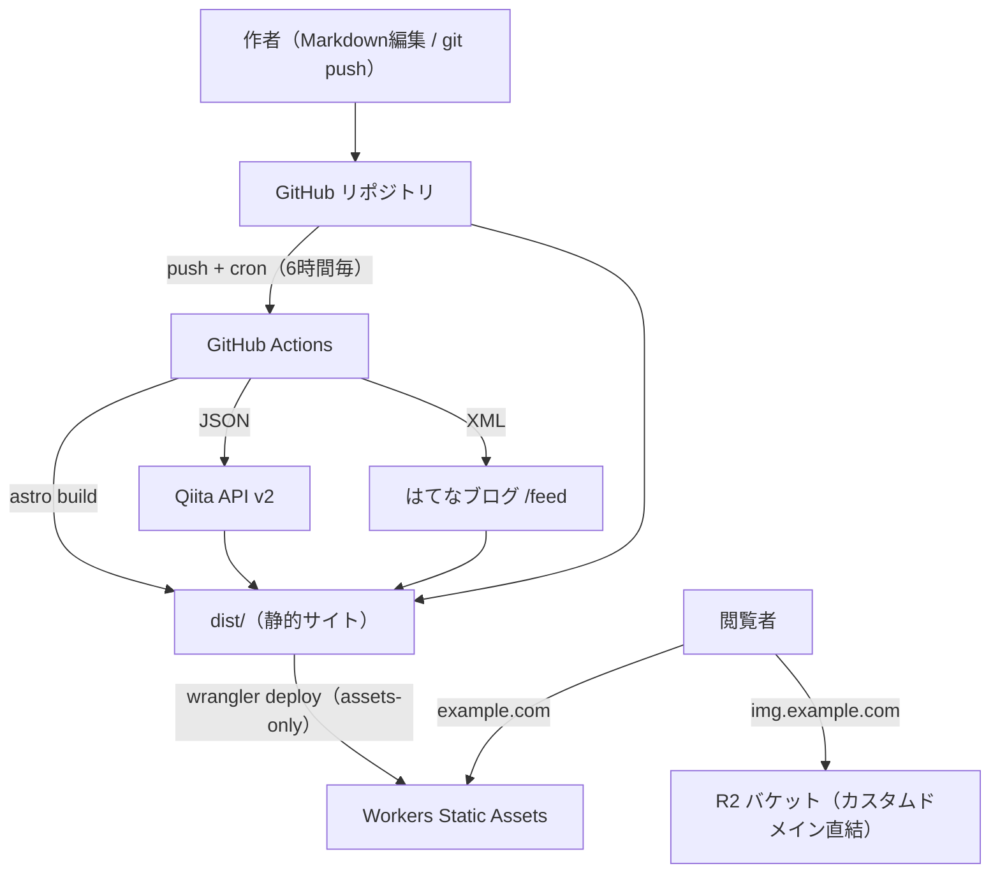

# ポートフォリオサイト 技術構成

- 更新日: 2026-10-11
- ステータス: 確定（初版）

## 1. 目的と要件

学生エンジニアのポートフォリオサイト。軽量・低保守・無料枠内での運用を最優先とする。

| # | 要件 | 決定 |
| --- | --- | --- |
| 1 | ブログ機能 | **持たない**。Qiita / はてなブログの記事をAPI・フィールドで取得し、リンク（タイトル・日付・タグ）として表示 |
| 2 | コンテンツ管理 | Markdown を Git リポジトリで管理 |
| 3 | 画像管理 | Cloudflare R2（カスタムドメインで公開配信） |
| 4 | ホスティング | Cloudflare Workers（Static Assets） |
| 5 | RDBMS | **使用しない**（D1 は必要になった時に追加） |
| 6 | CMS | **採用しない**（編集は github.dev / ローカル環境で行う） |

## 2. 全体アーキテクチャ



処理の流れ:

1. 作者が Markdown を編集して push（または cron が定期トリガー）
2. GitHub Actions が Qiita API・はてなブログフィードを取得して JSON を生成
3. `astro build` で全ページを静的生成
4. `wrangler deploy` で Workers に assets-only デプロイ（サーバーコードなし）
5. 閲覧者は Workers から HTML、R2 カスタムドメインから画像を受け取る

## 3. 技術スタック

| レイヤ | 技術 | バージョン目安 |
| --- | --- | --- |
| フレームワーク | Astro（`output: 'static'`、アダプタなし） | 5.x |
| 記述言語 | TypeScript | 5.x |
| ホスティング | Cloudflare Workers / Static Assets | — |
| 画像ストレージ | Cloudflare R2（バケット + カスタムドメイン） | — |
| CI/CD | GitHub Actions + Wrangler | node 22 |
| 外部データ取得 | Qiita API v2 / はてなブログ公開フィード + fast-xml-parser | — |
| パッケージマネージャ | npm | — |

## 4. 設計判断と理由

| 判断 | 採用 | 却下した案と理由 |
| --- | --- | --- |
| ホスティング | Workers (Static Assets) | Pages: 公式が新規プロジェクトに Workers を案内しておりメンテナンス状態 |
| フレームワーク | Astro | Hugo: はてなフィード（XML）のパースが Go template 上で困難。将来の SSR / D1 拡張も TS 一つで賄える |
| ブログ | 外部サービス集約・リンク表示 | 内製ブログ: 管理コストが要件に反する。リンク表示なら正規URLへの誘導で SEO・著作権も無難 |
| 記事取得タイミング | ビルド時（cron で定期リビルド） | リクエスト時 SSR + SWR: 実装が増える。鮮度要求（数時間遅れ可）で不要 |
| 画像配信 | R2 バケットにカスタムドメイン直結 | Worker 経由 `/img/*`: Worker コードが増える。動的変換が必要になった時に移行 |
| DB | なし | D1: 書き込み要件が無い。binding 追加だけで後から載せられるため先送り |
| CMS | なし | 編集頻度が低い想定で github.dev（repo で `.`）で十分 |

## 5. 各構成要素の詳細

### 5.1 フレームワーク: Astro

- `output: 'static'`（デフォルト）。SSR アダプタは導入しない
- コンテンツは Content Collections + zod で型安全に管理（frontmatter のスキーマ違反をビルド時に検出）
- デフォルトで JS ゼロ送出。必要な箇所のみ island として動的化

```js
// astro.config.mjs
import { defineConfig } from 'astro/config';

export default defineConfig({
  site: 'https://example.com', // sitemap・OGP の正規URLに使用
});
```

```ts
// src/content.config.ts
import { defineCollection, z } from 'astro:content';
import { glob } from 'astro/loaders';

const projects = defineCollection({
  loader: glob({ pattern: '**/*.md', base: './src/content/projects' }),
  schema: z.object({
    title: z.string(),
    published: z.coerce.date(),
    tags: z.array(z.string()).default([]),
    hero: z.string().url().optional(), // https://img.example.com/... の絶対URL
    draft: z.boolean().default(false),
  }),
});

export const collections = { projects };
```

### 5.2 ホスティング: Workers Static Assets（assets-only）

`main` を持たない assets-only デプロイ。Worker スクリプトなしの純静的配信で、静的アセットのリクエストは課金対象外。

```jsonc
// wrangler.jsonc
{
  "$schema": "node_modules/wrangler/config-schema.json",
  "name": "myweb",
  "compatibility_date": "2026-10-11",
  "assets": {
    "directory": "./dist",
    "not_found_handling": "404-page"
  }
}
```

### 5.3 外部ブログ連携（Qiita / はてなブログ）

ビルド時に取得し、単一の型に正規化して JSON 書き出し → Astro で静的描画。

| ソース | 取得方法 | 備考 |
| --- | --- | --- |
| Qiita | `GET https://qiita.com/api/v2/users/:id/items?per_page=100` | 無認証で可（60 req/時。ビルド時のみなら十分）。トークンがあれば制限緩和 |
| はてなブログ | `GET https://<user>.hatenablog.com/feed` | 公開フィード（XML）。AtomPub は投稿・編集用のため不使用 |

```ts
// scripts/fetch-articles.ts（要点）
type Article = {
  title: string;
  url: string;          // 正規URLへのリンク
  publishedAt: string;  // ISO 8601
  source: 'qiita' | 'hatena';
  tags: string[];
};

// Qiita: JSON そのまま（title / url / created_at / tags[].name）
// はてな: fast-xml-parser で title / link / dc:date 等を解析
// → publishedAt 降順にマージし src/data/articles.json へ書き出し
```

```astro
---
// src/pages/articles.astro
import articles from '../data/articles.json' with { type: 'json' };
---
<ul>
  {articles.map((a) => (
    <li>
      <a href={a.url} rel="noopener">{a.title}</a>
      <small>{a.source} · {new Date(a.publishedAt).toLocaleDateString('ja-JP')}</small>
    </li>
  ))}
</ul>
```

注意事項:

- 記事本体はコピーせず、タイトル・要約・リンクに留める（正規URL誘導）
- `articles.json` は生成物なので `.gitignore` に登録する
- 出力の全文を Astro 側で直接描画する代わりに、fetch スクリプトを Content Layer のカスタムローダーとして実装する拡張も可能

### 5.4 画像: Cloudflare R2

- バケットに**直接カスタムドメイン**（例: `img.example.com`）を接続して公開配信。Worker コード不要
  - カスタムドメイン接続には、同じ Cloudflare アカウント上にサイトのドメイン（ゾーン）が必要
  - `r2.dev` の公開URLはレート制限があるため本番では使わない
- Markdown からは絶対URLで参照: ``
- アップロードは `wrangler` コマンド（または小スクリプト）。キーは日付や内容ハッシュで衝突回避

```bash
# バケット作成（初回のみ）
npx wrangler r2 bucket create myweb-assets

# ダッシュボードでバケットにカスタムドメイン img.example.com を接続

# 画像アップロード
npx wrangler r2 object put myweb-assets/2026/hero.webp \
  --file ./hero.webp \
  --content-type image/webp \
  --cache-control "public, max-age=31536000, immutable"
```

- 最適化は**アップロード前の事前圧縮**（sharp 等で WebP/AVIF 変換・リサイズ）で行う。Cloudflare Image Transformations はトラフィックが伸びた時の選択肢

### 5.5 D1: 使用しない

書き込み要件（問い合わせフォーム・PV カウンタ等）が出てから、`wrangler.jsonc` に `d1_databases` の binding を 1 つ追加すれば済む。本章は意思決定の記録のみ。

## 6. CI/CD

GitHub Actions で `push` と `schedule`（6時間毎）をトリガーに、fetch → build → deploy を実行。

```yaml
# .github/workflows/deploy.yml
name: deploy
on:
  push:
    branches: [main]
  schedule:
    - cron: '0 */6 * * *'
  workflow_dispatch:
permissions:
  contents: read
jobs:
  deploy:
    runs-on: ubuntu-latest
    steps:
      - uses: actions/checkout@v4
      - uses: actions/setup-node@v4
        with:
          node-version: 22
          cache: npm
      - run: npm ci
      - run: npm run build
        env:
          QIITA_ACCESS_TOKEN: ${{ secrets.QIITA_ACCESS_TOKEN }}
      - run: npx wrangler deploy
        env:
          CLOUDFLARE_API_TOKEN: ${{ secrets.CLOUDFLARE_API_TOKEN }}
```

```json
// package.json（scripts 抜粋）
{
  "scripts": {
    "dev": "tsx scripts/fetch-articles.ts && astro dev",
    "build": "tsx scripts/fetch-articles.ts && astro build",
    "deploy": "npm run build && wrangler deploy"
  }
}
```

備考: GitHub Actions の `schedule` は数分の遅延が発生し得る（要件上問題なし）。

## 7. リポジトリ構成

```
.
├── docs/
│   └── architecture.md          # 本書
├── src/
│   ├── content/
│   │   └── projects/            # Markdown（about 等単発ページは pages/ に直書き）
│   ├── content.config.ts        # Content Collections 定義（zod）
│   ├── data/
│   │   └── articles.json        # fetch スクリプトが生成（gitignore）
│   ├── layouts/
│   ├── components/
│   ├── pages/
│   │   ├── index.astro
│   │   ├── about.astro
│   │   ├── projects/[...slug].astro
│   │   └── articles.astro       # Qiita / はてな リンク集
│   └── styles/
├── public/                      # favicon・OGP デフォルト画像等
├── scripts/
│   ├── fetch-articles.ts        # Qiita / はてな取得 → articles.json
│   └── optimize-image.ts        # 事前最適化（必要に応じて）
├── astro.config.mjs
├── wrangler.jsonc
└── .github/workflows/deploy.yml
```

## 8. シークレット管理

| シークレット | 用途 | 必須 |
| --- | --- | --- |
| `CLOUDFLARE_API_TOKEN` | `wrangler deploy` | 必須（最小スコープ: Workers Scripts Edit 等） |
| `QIITA_ACCESS_TOKEN` | Qiita API のレート制限緩和 | 任意 |

- シークレットは GitHub Secrets のみに保持し、リポジトリへコミットしない
- `articles.json` 等の生成物をコミットしない

## 9. コスト

| サービス | 無料枠 | 想定使用量 |
| --- | --- | --- |
| Workers | 10万 req/日（静的アセット配信は課金対象外） | 枠内 |
| R2 | 10 GB/月、Class A 100万/月、Class B 1000万/月、エグレス無料 | 枠内 |
| GitHub Actions | public repo 無料 / private 2,000分/月 | 6時間毎 ≈ 120ビルド/月で枠内 |

**全構成が無料枠内で完結する。**

## 10. 将来の拡張オプション

| 拡張 | 手段 | 移行コスト |
| --- | --- | --- |
| 記事の鮮度をリアルタイム化 | `@astrojs/cloudflare` 導入 + 記事ルートのみ `prerender = false`、Cache API で SWR | ルート単位で段階移行可 |
| 問い合わせフォーム / PV | D1 binding + Turnstile | binding 追加のみ |
| 編集UI（CMS） | Sveltia CMS（Git-based・R2メディア対応） | `/admin` 静的ページを追加するのみ |
| 画像の動的リサイズ | Worker 経由 `/img/*` に切替、または Cloudflare Image Transformations | 配信経路の変更のみ |

## 参照

- デザイン仕様: [design/design.md](./design/design.md)（モックアップ: [design/mockup.html](./design/mockup.html)）
- コンテンツ設計: [content.md](./content.md)
- Workers Static Assets: <https://developers.cloudflare.com/workers/static-assets/>
- Astro + Cloudflare: <https://developers.cloudflare.com/workers/framework-guides/>
- Qiita API v2: <https://qiita.com/api/v2/docs>
- はてなブログ API: <https://developer.hatena.ne.jp/ja/documents/blog/apis/atom>
- Cloudflare R2: <https://developers.cloudflare.com/r2/>
- Astro Content Collections: <https://docs.astro.build/ja/reference/modules/astro-content/>
